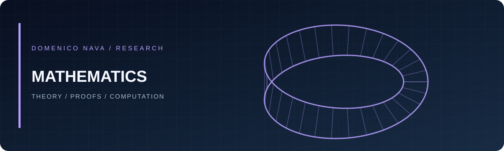

[← Home](../README.md) · [Quantitative Finance](quantitative-finance.md) · [Mathematics](mathematics.md) · [Machine Learning](machine-learning.md) · [Private Research](private-research.md)

# Mathematics

A space for mathematical foundations, derivations, and computational experiments.

| Area | What belongs here |
|:--|:--|
| **Probability & Stochastic Processes** | Random processes, Brownian motion, Ito calculus and simulation |
| **Differential Equations** | ODEs, PDEs and their applications |
| **Numerical Analysis** | Discretisation, convergence, stability and approximation |
| **Optimisation** | Numerical optimisation and mathematical modelling |

### Work in progress · More material coming soon

> 🚧 **Under construction.** I am gradually preparing detailed README notes, mathematical derivations, LaTeX-style write-ups, PDF presentations, and reproducible notebooks. Some work is still private or being refined before publication.

### Planned notes & presentations

| Topic | Planned material | Status |
|:--|:--|:--|
| Stochastic calculus & probability | Derivations, examples and notebooks | 📝 TBD |
| Differential equations | Mathematical notes and numerical experiments | 📝 TBD |
| Numerical analysis | Algorithms, convergence and error studies | 📝 TBD |
| Optimisation | Theory and computational demonstrations | 📝 TBD |

### Projects and documents

<!-- Duplicate the following template as you publish material. -->
<!-- - **[Project title](https://github.com/dom00mi/REPOSITORY)** — one-line description. -->
<!-- - **[Presentation (PDF)](../documents/presentation.pdf)** — upload the PDF to documents/ first. -->

*Links will be added as materials are published.*

---

[← Back to portfolio](../README.md) · [Contact me](mailto:domenico.nava.dn@gmail.com)

