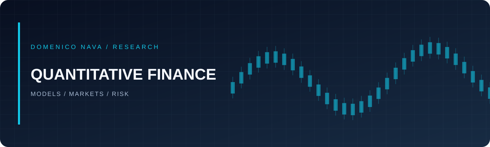

[← Home](../README.md) · [Quantitative Finance](quantitative-finance.md) · [Mathematics](mathematics.md) · [Machine Learning](machine-learning.md) · [Private Research](private-research.md)

# Quantitative Finance

Research and implementations at the intersection of stochastic modelling, computational finance, and financial markets.

| Project | Focus | Stack |
|:--|:--|:--|
| **Dynamic Delta Hedging App** | Actual vs implied hedging, volatility-arbitrage P&L and interactive visualisation | `Streamlit` `Plotly` |
| **Market-Making Model with Poisson Processes** | Order imbalance, policy optimisation and Monte Carlo estimation | `Python` `Monte Carlo` |
| **UK Yield Curve Modelling via PCA** | Yield-curve factors, dimensionality reduction and correlation structure | `scikit-learn` `Plotly` |

### Topics I explore

`Option Pricing` · `Stochastic Volatility` · `SVI Calibration` · `Hedging` · `Market Microstructure` · `Yield Curves`

> **Repository links:** Specific repository URLs can be added here once their names and public visibility are confirmed. [Browse my GitHub repositories](https://github.com/dom00mi?tab=repositories).

### Suggested format for each project

<b>Project overview template</b>

**Problem:** What financial question is the model answering?

**Method:** Key assumptions, equations and numerical approach.

**Implementation:** Libraries, reproducible notebook or application.

**Results:** Diagnostics, visualisations and limitations.

**Code:** Link to the corresponding repository when available.

> 🚧 **Work in progress.** Selected projects are being refined and will be linked here as they become ready. Some research remains private; see the [access guide](private-research.md).

### Project links (to be added)

<!-- Add one line per published repository: -->
<!-- - **[Project name](https://github.com/dom00mi/REPO-NAME)** — Short description. -->

*Project links: TBD.*

---

[← Back to portfolio](../README.md) · [Contact me](mailto:domenico.nava.dn@gmail.com)

